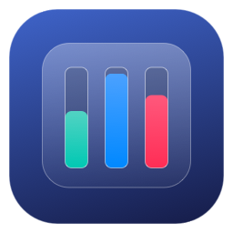
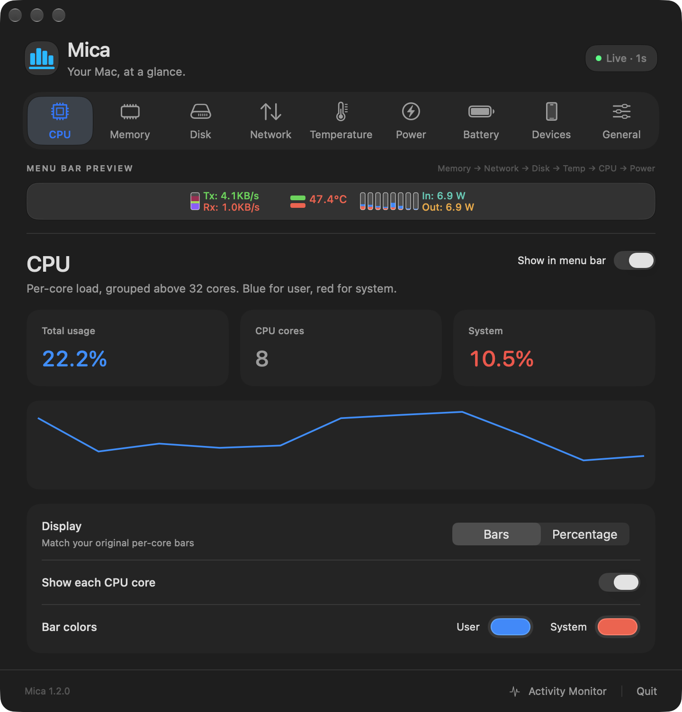
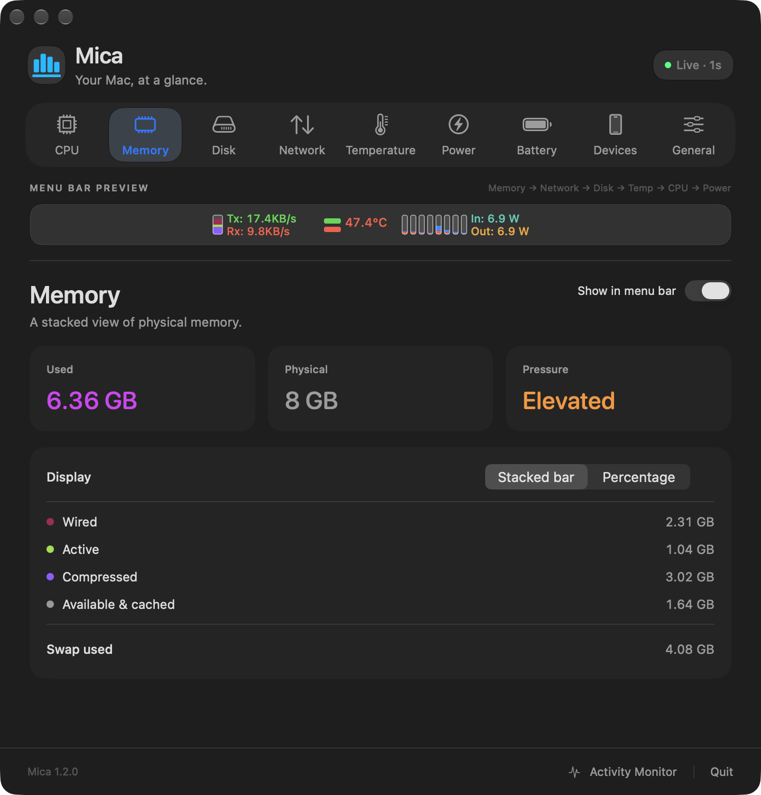
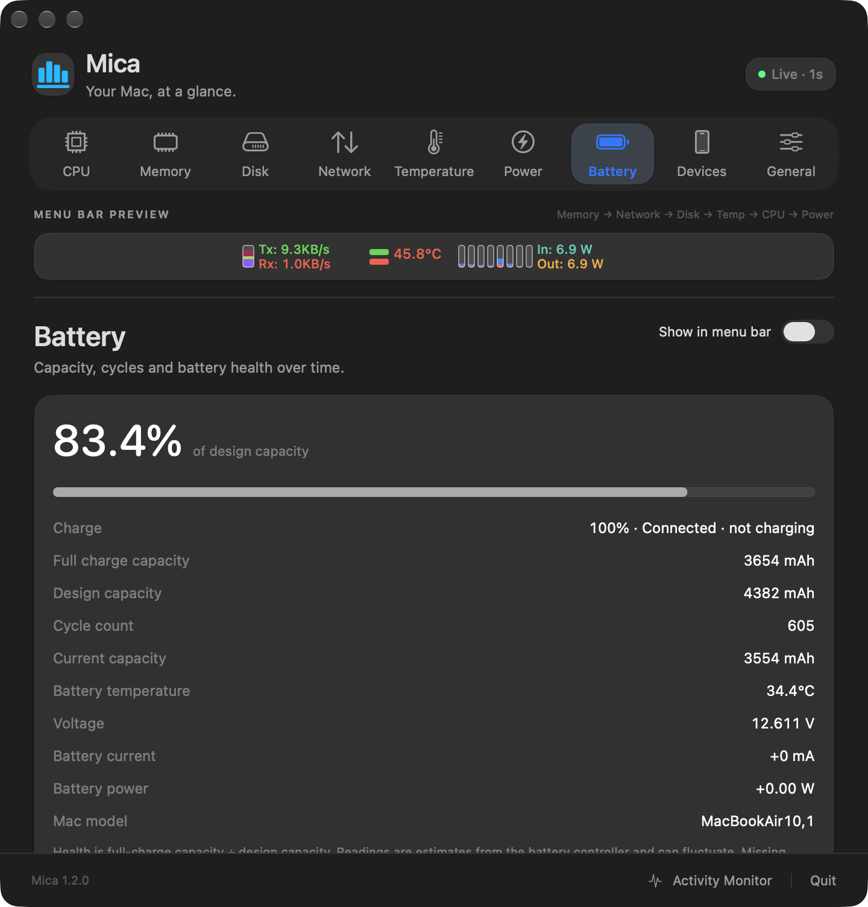
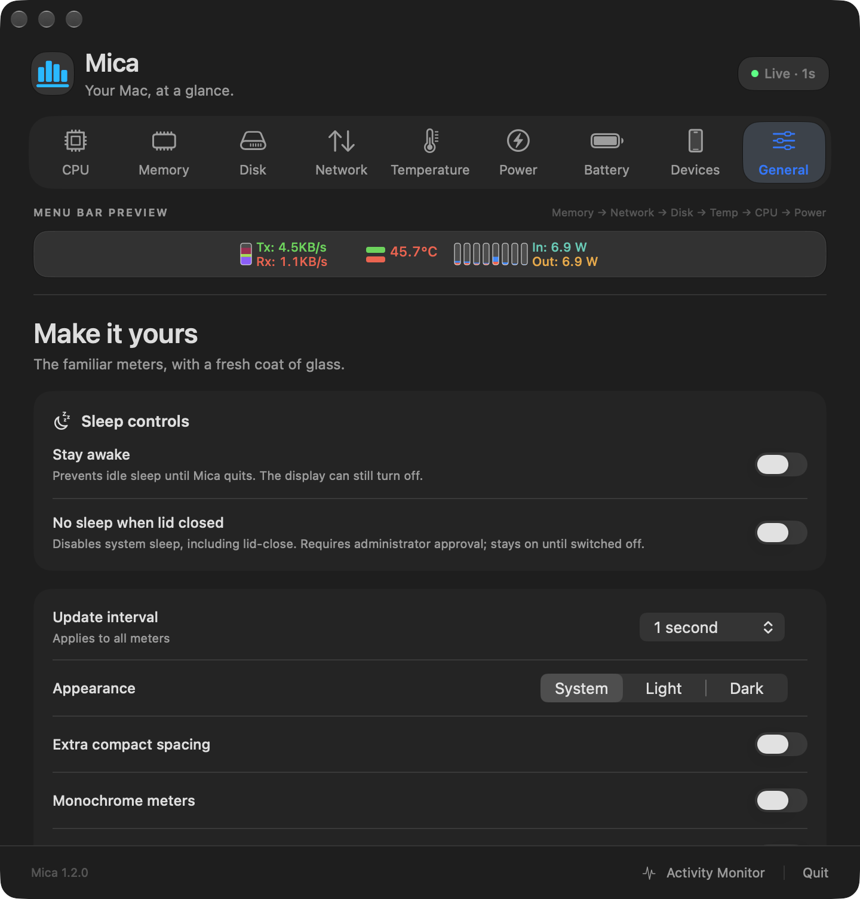

<p align="center">
  
</p>

<h1 align="center">Mica</h1>
<p align="center">A macOS menu bar app for system monitoring, battery diagnostics and sleep controls.</p>
<p align="center"><a href="#install">Install with Homebrew</a> · <a href="#screenshots">Screenshots</a> · <a href="#privacy">Privacy</a> · <a href="DEVELOPMENT.md">Developer guide</a></p>

<p align="center"></p>

Mica includes system meters similar to MenuMeters, battery diagnostics similar
to coconutBattery, and idle-sleep prevention similar to Caffeine and Amphetamine.
It is free and [MIT licensed](LICENSE).

## Install

```sh
brew install --cask angad/tap/mica
```

Or [download the latest preview](https://github.com/angad/Mica/releases/tag/v1.2.0)
and drag Mica to Applications. Mica requires macOS 12.3 Monterey or later and
supports Apple Silicon and Intel.

The current preview is ad-hoc signed and not yet notarized. If macOS blocks
its first launch, review [Apple's instructions for opening an app you trust](https://support.apple.com/en-us/102445).
Homebrew preserves macOS security checks. [Installation details](docs/HOMEBREW.md).

## System monitoring

| Meter | Data shown |
| --- | --- |
| CPU | Total load, per-core user/system usage and recent history |
| Memory | Used and available RAM, memory pressure, wired, active and compressed memory, and swap |
| Network | Upload/download rates and the selected network interface |
| Storage | Disk read/write activity |
| Temperature | Readings from available hardware sensors |
| Power | Charger input, system power draw and session energy |

Click a meter to open its details. The layout, colors, update interval and
appearance are configurable. CPU and memory support bar and percentage displays.
Mica uses Liquid Glass on macOS 26+ and native material surfaces on older versions.

## Battery diagnostics

Mica displays battery charge, capacity health, full-charge and design capacity,
cycle count, temperature, voltage and current. Capacity health is full-charge
capacity divided by design capacity, expressed as a percentage.

Battery history supports manual snapshots and optional hourly saving. Reports
can be exported as JSON, and history as CSV. History is stored on the Mac.

iPhone and iPad diagnostics are available for devices paired with the Mac.
Install `libimobiledevice` separately and enable Devices in settings. Available
battery fields depend on the device and iOS version.

## Sleep controls

The Stay awake switch prevents idle system sleep until it is disabled or Mica
quits. The display can still turn off.

A separate, opt-in **No sleep when lid closed** control is available on notebooks.
It needs macOS administrator approval and stays enabled until you turn it off.
Turn it off before carrying your Mac in a bag.

## Screenshots

Screenshots of Mica 1.2.0 running on an M1 MacBook Air.

<table>
  <tr>
    <td width="50%"><br><strong>CPU</strong></td>
    <td width="50%"><br><strong>Memory</strong></td>
  </tr>
  <tr>
    <td><br><strong>Battery diagnostics</strong></td>
    <td><br><strong>Sleep controls</strong></td>
  </tr>
</table>

## Privacy

Mica has no analytics, telemetry or tracking SDKs. It reads hardware statistics
locally and does not send them to a Mica service or analytics provider. It does
not require an account and has no ads or cloud uploads.

Mica saves battery history locally after a manual snapshot or when hourly saving
is enabled. The app exports reports only when requested. Optional Wi-Fi
device reads use existing local pairing. [Privacy details](SECURITY.md).

## CPU and memory usage

Measured for the Mica process, with the settings window closed and the menu bar
updating every second:

| Resource | M1 MacBook Air sample |
| --- | --- |
| CPU | 3.8% of one core, average |
| Resident memory (RSS) | 38.6 MiB, median |
| Peak resident memory (RSS) | 39.4 MiB |

One 60-second sample on an 8 GB M1 MacBook Air running macOS 27.0.1, Mica 1.2.0.
Other apps were running. RSS counts resident pages; it is not total allocated
memory. Usage varies with hardware, sensors and settings.
[Method and raw measurements](docs/PERFORMANCE.md).

## Project information

Mica is an independent implementation. It does not implement every feature of
the applications listed above. Sensor availability varies by Mac model and
firmware. [Compatibility](docs/COMPATIBILITY.md) ·
[Validation](VALIDATION.md).

Maintained by [Angad Singh](https://github.com/angad).
[Developer guide](DEVELOPMENT.md) · [Contributing](CONTRIBUTING.md) ·
[Report an issue](https://github.com/angad/Mica/issues).
